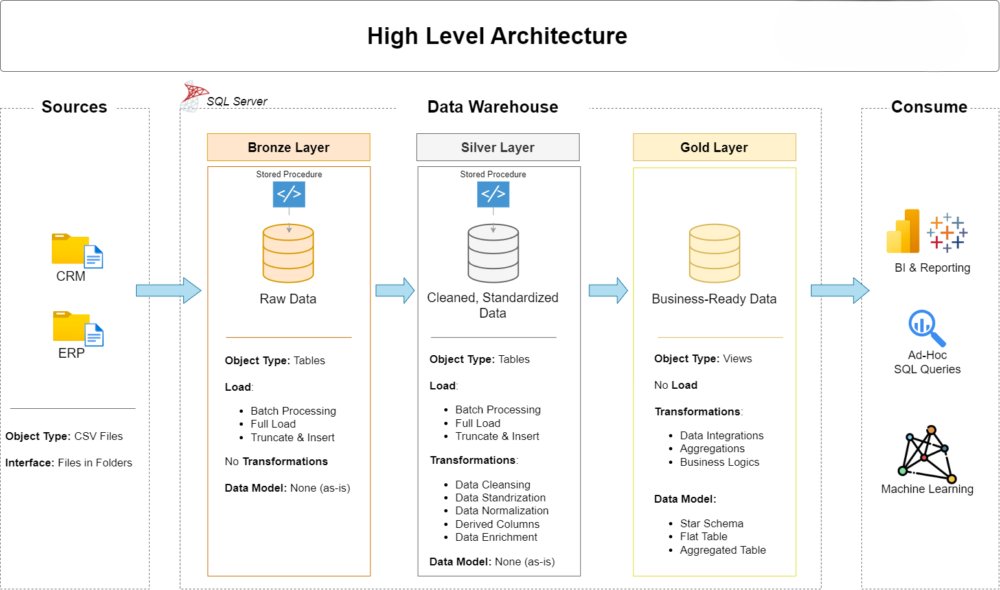

# SQL-Data-Warehouse-Project
Building a modern data warehouse using SQL Server , including ETL process , data modeling , and analytics.

You take raw files from two systems, a CRM and an ERP, and build one data warehouse in SQL Server. At the end, the data is clean and ready for analysis.


```
SQL-Data-Warehouse-Project/

├── datasets/               the six source files the project loads
│   ├── source_crm/         three files from the CRM system
│   └── source_erp/         three files from the ERP system
├── docs/                   the requirements, the diagrams 
├── scripts/                the project scripts
|   ├──init_database.sql    creates the database: run it first
│   ├── bronze/             loads the raw files
│   ├── silver/             cleans and prepares the data
|   ├── proc_dwh.sql        run this to create and load bronze and silver 
│   └── gold/               builds the tables for analysis
└── tests/                  checks the quality of the silver and gold data
```

---
## 🏗️ Data Architecture

The data architecture for this project follows Medallion Architecture **Bronze**, **Silver**, and **Gold** layers:


1. **Bronze Layer**: Stores raw data as-is from the source systems. Data is ingested from CSV Files into SQL Server Database.
2. **Silver Layer**: This layer includes data cleansing, standardization, and normalization processes to prepare data for analysis.
3. **Gold Layer**: Houses business-ready data modeled into a star schema required for reporting and analytics.


---
## 📖 Project Overview

In this project:

1. **Design the architecture:** a modern data warehouse with three layers, bronze, silver and gold.
2. **Build the ETL pipelines:** load the source files and move the data through the layers.
3. **Model the data:** facts and dimensions, ready for reports.
4. **Analyze it:** answer business questions with SQL.

---

## 🛠️ Important Links & Tools

- **[Git](https://github.com/):** a GitHub account, to save and share your project.
- **[draw.io](https://www.drawio.com/):** to draw the architecture and the data model.
- **[Notion template](https://app.notion.com/p/SQL-Data-Warehouse-Project-1bc0719e7ef483ff959f01762723dafc):** the project plan, ready to copy.
---

## 🚀 Project Requirements

### Building the Data Warehouse (Data Engineering)

#### Objective
Develop a modern data warehouse using SQL Server to consolidate sales data, enabling analytical reporting and informed decision-making.

#### Specifications
- **Data Sources**: Import data from two source systems (ERP and CRM) provided as CSV files.
- **Data Quality**: Cleanse and resolve data quality issues prior to analysis.
- **Integration**: Combine both sources into a single, user-friendly data model designed for analytical queries.
- **Scope**: Focus on the latest dataset only; historization of data is not required.
- **Documentation**: Provide clear documentation of the data model to support both business stakeholders and analytics teams.

---

### BI: Analytics & Reporting (Data Analysis)

#### Objective
Develop SQL-based analytics to deliver detailed insights into:
- **Customer Behavior**
- **Product Performance**
- **Sales Trends**

These insights empower stakeholders with key business metrics, enabling strategic decision-making.  

---